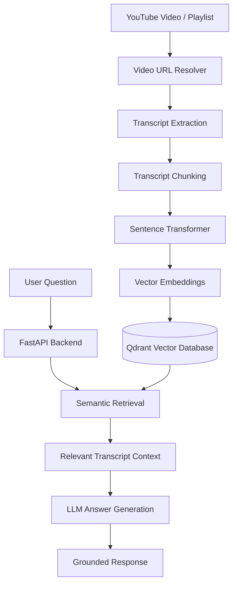

# 🎥 VideoRAG — Chat with YouTube Videos

**Turn YouTube videos into searchable knowledge.**

VideoRAG is a Retrieval-Augmented Generation (RAG) application that allows users to interact with YouTube videos using natural language. Instead of watching hours of content to find specific information, users can index video transcripts and ask questions to retrieve relevant, timestamp-aware context.

Built with **FastAPI, Qdrant, Sentence Transformers, and LLM-powered retrieval**, VideoRAG transforms video content into a searchable knowledge base.

---

## ✨ Features

- **YouTube Video Ingestion:** Index individual YouTube videos and playlists.
- **Transcript Extraction:** Automatically retrieve available YouTube transcripts.
- **Intelligent Chunking:** Split transcripts into manageable, overlapping chunks while preserving video context.
- **Semantic Search:** Generate vector embeddings using Sentence Transformers and retrieve relevant passages through Qdrant.
- **AI-Powered Q&A:** Ask natural-language questions and generate context-grounded answers using LLM providers.
- **Streaming Ingestion:** Monitor indexing progress through real-time progress events.
- **Video Library Management:** Browse indexed videos and remove videos from the knowledge base.
- **Configurable Retrieval:** Customize chunk duration, overlap, maximum results, and embedding models.
- **Flexible LLM Providers:** Support for Groq, OpenAI, and Anthropic.

## 🏗️ Architecture



## 🛠️ Tech Stack

| Component | Technology |
|---|---|
| Backend | Python, FastAPI |
| Frontend | HTML, CSS, JavaScript |
| Vector Database | Qdrant |
| Embeddings | Sentence Transformers |
| Embedding Model | all-MiniLM-L6-v2 |
| Transcript Extraction | youtube-transcript-api |
| Video Processing | yt-dlp |
| LLM Integration | Groq, OpenAI, Anthropic |
| API Server | Uvicorn |

## ⚙️ Getting Started

### 1. Clone the repository

```bash
git clone https://github.com/tarun0517/VideoRAG.git
cd VideoRAG
```

### 2. Create a virtual environment

```bash
python -m venv venv
```

Activate it:

**Windows**
```bash
venv\Scripts\activate
```

**Linux / macOS**
```bash
source venv/bin/activate
```

### 3. Install dependencies

```bash
pip install -r requirements.txt
```

### 4. Configure environment variables

Create your environment file:

```bash
cp .env.example .env
```

On Windows PowerShell:

```powershell
Copy-Item .env.example .env
```

Configure the following variables:

```env
# Qdrant Configuration
QDRANT_URL=
QDRANT_API_KEY=
QDRANT_LOCAL_PATH=./qdrant_data
COLLECTION_NAME=videorag

# Embedding Configuration
EMBEDDING_MODEL=sentence-transformers/all-MiniLM-L6-v2

# LLM Configuration
LLM_PROVIDER=groq
GROQ_API_KEY=
GROQ_MODEL=llama-3.1-8b-instant

OPENAI_API_KEY=
ANTHROPIC_API_KEY=

# Retrieval Configuration
CHUNK_SECONDS=60
CHUNK_OVERLAP_SECONDS=10
MAX_CHUNK_CHARS=1500
MAX_PLAYLIST_VIDEOS=50
TOP_K=6

# CORS
CORS_ORIGINS=*
```

**Note:** Configure either a Qdrant Cloud instance or local embedded Qdrant storage. API keys are optional for local embedding and retrieval; an LLM API key is needed for AI-generated answers.

### 5. Run the application

From the project root:

```bash
uvicorn backend.main:app --reload
```

The application will be available at:

```text
http://localhost:8000
```

API documentation:

```text
http://localhost:8000/docs
```

---

## 🔌 API Endpoints

| Method | Endpoint | Description |
|---|---|---|
| GET | `/api/status` | Check application and Qdrant health |
| POST | `/api/index` | Index a YouTube video or playlist |
| POST | `/api/index/stream` | Stream indexing progress |
| POST | `/api/chat` | Ask questions about indexed videos |
| GET | `/api/videos` | Retrieve indexed video library |
| DELETE | `/api/videos/{video_id}` | Remove an indexed video |

Interactive API documentation is available through FastAPI Swagger UI at `/docs`.

## 🧠 How It Works

**1. Video Ingestion**

The application accepts a YouTube video or playlist URL and resolves it into individual videos.

**2. Transcript Extraction**

Available transcripts are extracted using the YouTube Transcript API.

**3. Intelligent Chunking**

Transcript segments are divided into configurable chunks with overlapping context to preserve continuity between neighbouring passages.

**4. Embedding Generation**

Sentence Transformers converts transcript chunks into dense vector representations.

**5. Vector Storage**

Generated embeddings and associated video metadata are stored in Qdrant for efficient similarity-based retrieval.

**6. Semantic Retrieval**

When a user asks a question, VideoRAG converts the query into an embedding and retrieves the most relevant transcript passages.

**7. Answer Generation**

The retrieved context is passed to the configured LLM provider to generate a context-grounded response.

---

## 🔮 Future Improvements

- Timestamp-linked answers with direct navigation to relevant video segments.
- Support for additional video platforms.
- Multimodal retrieval using video frames and visual embeddings.
- Hybrid search combining keyword and semantic retrieval.
- Conversation history and persistent user sessions.
- Improved retrieval evaluation and ranking strategies.

## 👨‍💻 Author

**Tarun Vadhel**

Electronics & Instrumentation Engineering  
National Institute of Technology, Rourkela

- GitHub: [@tarun0517](https://github.com/tarun0517)
- Project: [VideoRAG](https://github.com/tarun0517/VideoRAG)

---

⭐ If you find this project interesting, consider giving the repository a star!
